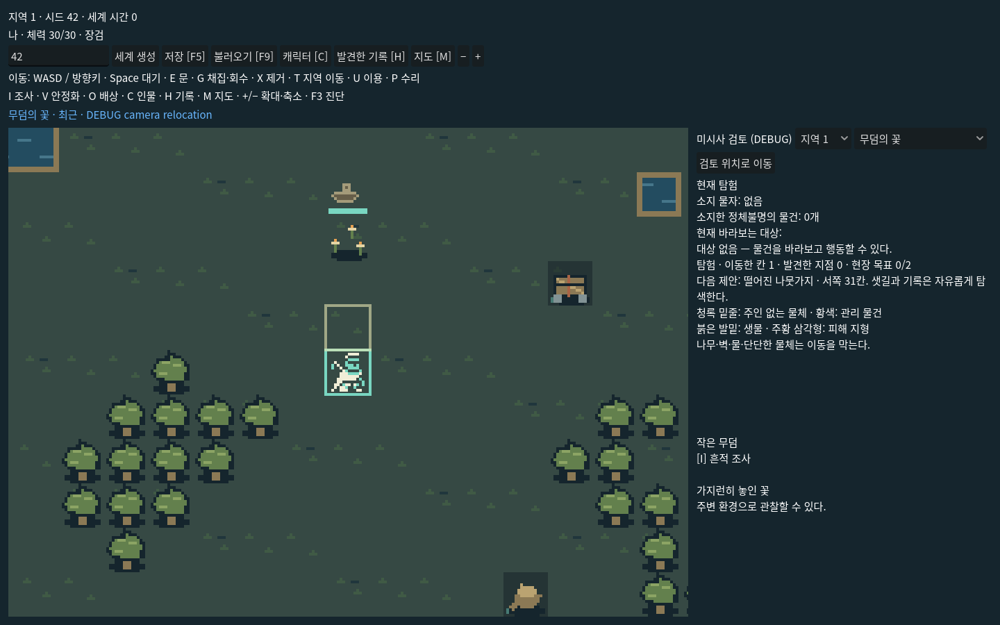
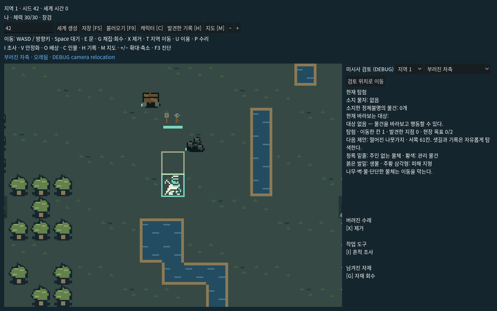
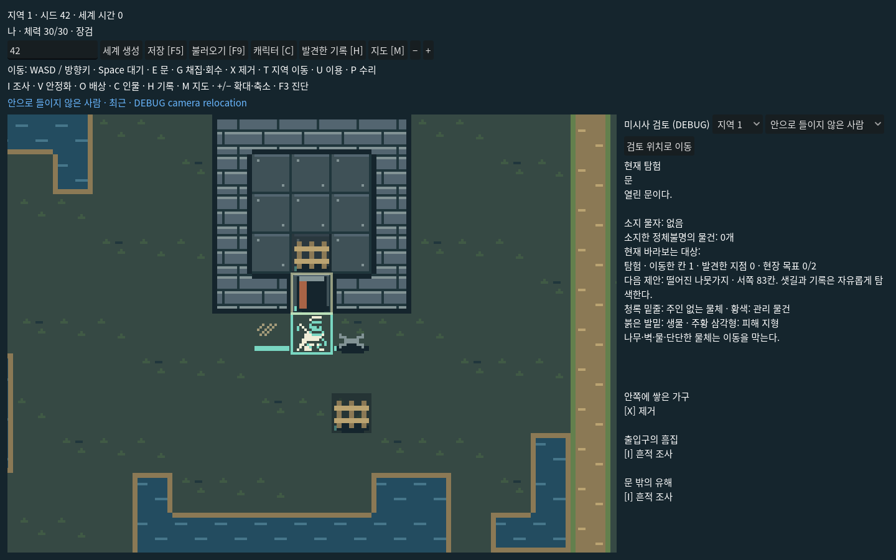
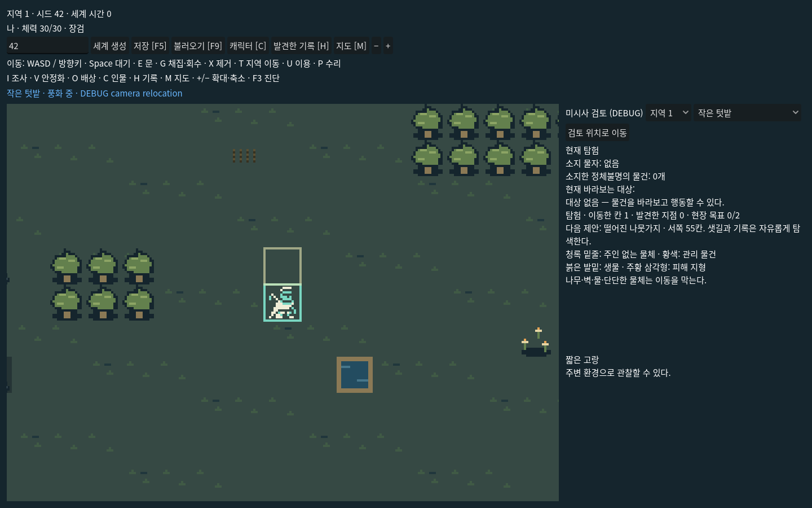
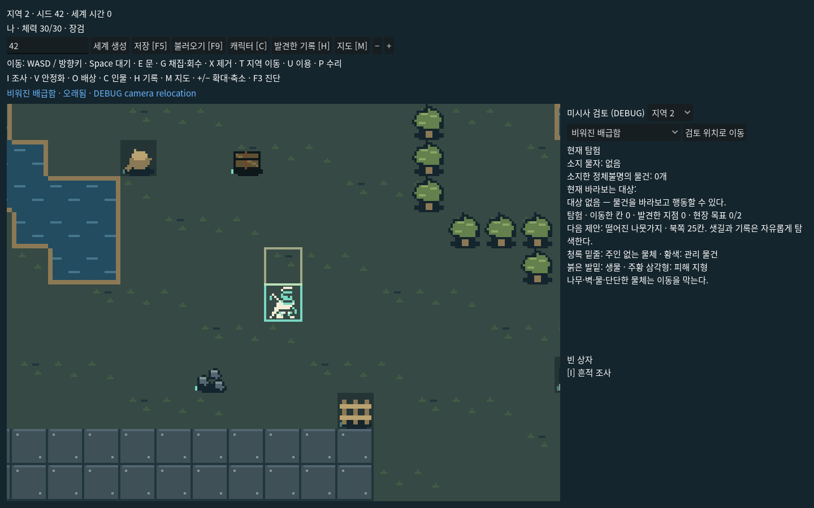
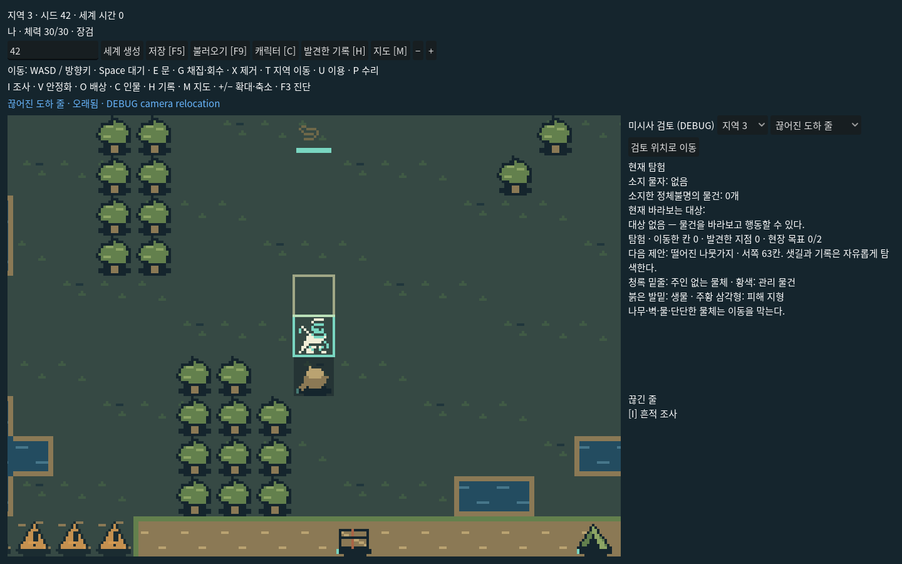
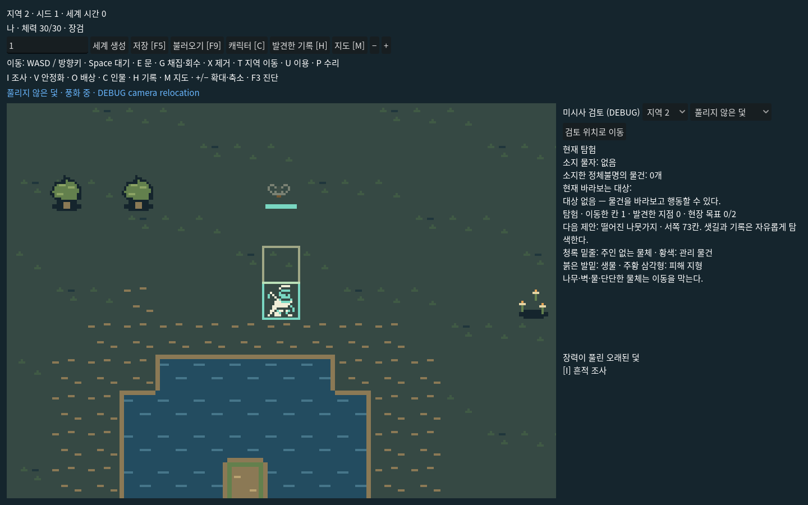
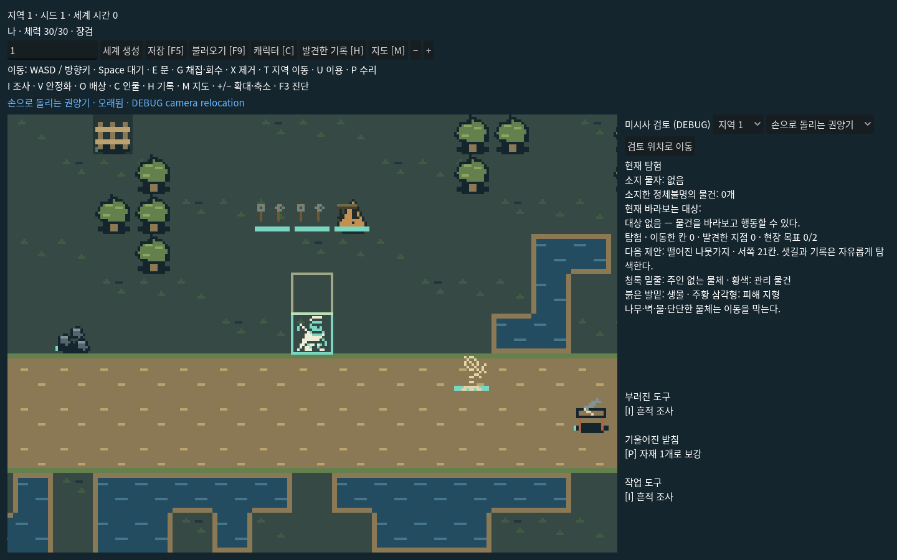

# M049 Microhistory v7 — 구현·검증 보고

2026-10-31. 작업 브랜치 `codex/history-generator-v7-microhistory`, 기반 `a8e32955ab7047000e648f8c0d2256a9bdfff0f9`. main 미병합. 커밋/원격 영수증은 최종 응답과 `C:/GameDev/microhistory-v7-work-record.md`에 기록한다.

## 구현과 기존 경로

36개 원형, 72개 결과, 46개 증거 유형, 11개 공간 양식을 구현했다. M048/M049의 16px 지도·Actor·Action·Scheduler·inventory·runtime override를 재사용한다. 별도의 HistoryEngine이나 전투 시계를 추가하지 않았다. 기존 v2–v6 거시 코드와 카탈로그를 변경하지 않았다. 새 `history_zone/3` 소비자와 `history_play_save/3`만 미시사를 생성하며 /1,/2 저장과 기본 씬은 유지한다.

실제 조회한 기존 콘텐츠는 events283 / social44 / traces116 / questions40 / interactions60 / actions21이다. v5 원형 네 가지와 물질 어휘를 연결하고 실제 Trace 인스턴스를 받는 material-analogy 어댑터를 테스트했다. 현 v6 Manifest에 없는 v5 Trace ID를 만들어 넣지는 않는다. v5 질문 전체의 현재 공간 연결은 아직 후속 범위다.

## 자동 생성 측정

샘플은 `SeedDeriver(490007, [microhistory_corpus,index]) mod 2147483647`의 index0–499이다. 원시64bit Seed 예비 실행은 기존 Manifest 정수 계약에 맞지 않아 저장 실패했고, 기존 지원 범위인31bit 샘플로 변경했다. Seed별 수동 예외는 없다. 전체 수치의 분모는 사건 수이며 타일 수가 아니다.

| 지표 | 결과 |
|---|---:|
| 세계 / 지역 | 500 / 1500 |
| 객관적 사건 | 8,298 |
| 지역당 사건 | 5.532 (4–7) |
| 실제 배치 | 6,027 (72.63%) |
| 증거 소멸 | 2,006 (24.17%) |
| 안전한 공간 부족 | 265 (3.19%) |
| 시설과 독립 공존 | 6,606 (79.61%) |
| 시설 맥락 연결 | 1,692 (20.39%) |
| 구조적으로 접근 가능한 장면 | 6,027 / 6,027 |
| 실행 가능한 동사가 있는 장면 | 5,336 / 6,027 (88.53%) |
| 실행/공간/인과 검증 오류 | 0 |
| 도달한 원형 / 결과 / 실제 증거 유형 | 36 / 72 / 46 |

| 계열 | 수 | 사건 중 비율 |
|---|---:|---:|
| 일상 | 1816 | 21.88% |
| 탐험·기묘한 발견 | 524 | 6.31% |
| 기계·생물 | 1081 | 13.03% |
| 개인·관계 | 1936 | 23.33% |
| 이동·거래 | 1883 | 22.69% |
| 폭력·비극 | 1058 | 12.75% |

| 선택 카테고리 | 수 | 비율 |
|---|---:|---:|
| accident | 2014 | 24.27% |
| conflict | 1936 | 23.33% |
| horror | 558 | 6.72% |
| ordinary | 2470 | 29.77% |
| tragedy | 1320 | 15.91% |

tragedy/horror **선택 카테고리**는 22.63%이나 **실제 결과 severity≥3**은 1,979/8,298, **23.85%**다. 성공적 구조·자발적 격리 종료·살아남은 일상 결과를 참사로 부풀리지 않는다. 전체 초기35% 목표에는 미달한다. 정착지 사건이 74.75%인 현재3지역 선택 구조를 보존했고 억지 배치를 하지 않았다.

| 환경 | 실제 severity≥3 | 초기 참고 범위 |
|---|---:|---|
| settlement | 1278/6203 (20.60%) | 10–20% |
| road | 190/796 (23.87%) | 20–30% |
| ruins | 94/236 (39.83%) | 35–50% |
| danger | 417/1063 (39.23%) | 45–65% |

환경별 실제 심각도 빈도에는 참고범위와 차이가 있다. 이 차이를 숨기지 않으며, 별도 콘텐츠/환경 비율 튜닝 대상으로 남긴다. 현재 심각한 사건 자체는 극저빈도가 아니다.

| 경과 시간 | 수 | 비율 |
|---|---:|---:|
| ancient | 1947 | 23.46% |
| old | 2115 | 25.49% |
| recent | 2132 | 25.69% |
| weathered | 2104 | 25.36% |

## 반복과 정성 검토

이름·ID·문장·좌표를 제외하고 `layout + 남은 증거 kind + 실제 verb + active 여부`로 계산한 조합은 **277종**이다. 전체 사건 반복 비율(1−고유조합/사건수)은 **96.66%**다. 소멸 장면도 같은 빈 조합으로 반복 집계한다. 서로 다른 Seed를 각각 독창적인 이야기로 세지 않는다.

배치된 장면 중 증거1개는 2,353/6,027 (39.04%)다. 이런 장면은 관계 추론보다 분위기에 가깝다. 초기 원형 조합 자체가 유한하므로 비반복성 달성을 주장하지 않는다.

[무작위20지역 전체](random_regions_500.md)는 각 사건의 사실·지역 적합성·잔존 증거·발견·비공개 사실·반복 문제를 보존한다. 선정 목록은 생성 전에 고정했고 좋은 Seed로 교체하지 않았다. [지역별 추가 검토](qualitative_notes.md)는 실제 약점과 수정 이유를 기록한다. 에이전트의 자료/화면 검토이며 인간 플레이어의 평가가 아니다.

## 성능

측정은 Windows Godot4.7.2, NVIDIA RTX5070Ti 환경이며 다른 로컬 작업과 자원을 공유했다. 벤치마크 전용 격리 측정은 아니다. 아래 생성 비용은 세 지역 전체이며 저장/로드는20세계 표본 평균이다.

| 항목 | 평균 |
|---|---:|
| 거시 생성 | 62.16 ms/world |
| 3지역 기존 탐험+미시사 실체화 | 209.66 ms/world |
| 검증(재생성 비교/BFS 포함) | 46.64 ms/world |
| 저장 직렬화 | 2.52 ms |
| 로드+재구성+동일성 확인 | 220.21 ms |
| 저장 크기 | 28930 bytes |

## 실제 행동·회귀·화면

- `tests/test_microhistory.gd`: 1,859 checks, 0 failures. 실제 Action을 통한 조사·회수·제거·자재소비 보강·위험 제거·걷기·지역왕복·저장복원. 기존 객체/자산/지형/Actor spawn 불변, 카탈로그순서 독립, 미래증거·가짜종족·기술·override 거부. 실제 v5 Trace 참조67건 확인.

- `bash tools/check_godot.sh`: **exit0**, 기존45+신규1=**46개 스크립트** 및 editor import/startup/dataset freshness 통과. v2~v5 역사, v6 A/B/C, 한국어, 기존 탐험/전투/시간 포함. [로그](full-gate.log).

전체 gate 이후의 최종 보완은 집중1859검사와 500세계 재집계 및 리소스 audit로 검증했다. [호환성 보고](compatibility.md)에 실행 순서, 기존 wiki metadata 검사 실패, 원본 보존 결과를 구분해 기록했다.

- 500세계/1500지역 전체 인과·공간·카탈로그순서 검사,20세계 저장복원 검사. 이는500번의 인간 플레이나 모두에 대한 왕복 행위 수행을 뜻하지 않는다.

- 실제 OpenGL3.3 Godot 렌더러에서8개 장면을1440×900으로 캡처하고 열어 확인했다. [캡처 메타데이터](captures.json). DEBUG 위치 이동 사용을 화면에 표시했고, 이를 실제 여행 증거로 세지 않았다.

- 첫 화면 검토에서 발자국이 위험표식처럼 보이던 문제, 오래된 덫의 활성 문구를 수정했다. 무작위 보고에서 발견한 수백년 발자국을 제거했고, 이동/도하 장소를 실제 길/물가로 제한했다. [1차 집계](iteration1_corpus.json)는 실패를 숨기지 않도록 보존했다.

- 인간의 장시간 자유 탐험, 재미·난이도 승인, 패키지 export, 다른 GPU/언어 품질 승인은 미실시다.

## 요청한 최종 질문에 대한 답

1. **랜덤 장식과 다른 점:** 사건 전제·실제 결과가 증거를 제한한다. 사망 없는 결과에 사람 유해를 만들지 않고, 가져간 짐을 현장 보상으로 남기지 않는다. 생존/사망/미회수 결과와 시간에 따라 현재 물건과 행동이 달라진다.

2. **독립 사건:** 79.61%가 시설 연관 없이 생성된다. 연결된 것도 거시 사건의 원인으로 단정하지 않는다.

3. **일상과 비극:** 함께 생성되며 결과 기준23.85%가 심각하다. 초기35% 전체 목표와 위험환경 참고범위는 미달했다.

4. **물리 반영:** 실제 벽·문틀·안쪽 가구·유해·도구·자재·위험을 배치하고 이동/충돌/회수/보강에 반영한다.

5. **설명 없는 추론:** 가구 안쪽/유해 바깥, 도구와 받침, 무덤과 꽃은 배치로 일부 추론할 수 있다. 단일 파편 장면은 구체적 사건을 읽기 어렵고 개선 여지가 크다.

6. **개입 없는 흥미:** Passive/미해결 장면이 존재한다. 흥미 자체의 인간 평가는 아직 없다. 모든 장면에 보상을 강요하지 않았다.

7. **세 지역의 다양성:** 독립적으로 생성된 사건·경과·현재 증거·선택 행동이 달라졌다. 기존 주 통로/현장 목표가 같아 전반적인 탐험 순서의 반복까지 해결하지는 않았다.

8. **비반복성:** 이름을 제외한277조합/높은 반복률을 공개한다. 이야기가8298개라고 독창적 장면8298종이라고 주장하지 않는다.

9. **중복 구조:** 거시 엔진·전투·스케줄러는 그대로다. 새 Planner/Realization과 작은 실행·표시 어댑터만 추가했다. v5 전체 질문을 중복 구현하지 않았다.

10. **구현과 제안:** 데이터·생성·현재 증거·실체화·상호작용·저장·회귀·GPU는 구현/검증했다. 풍부한 자동기계/구조대상 NPC, v5 조사전체 바인딩, 공간양식 확장, 체감 품질과 빈도 튜닝은 후속이다.

## 실행

Godot에서 `scenes/debug/microhistory_playground.tscn`을 열고 F6. Seed 입력 → 세계 생성. WASD/방향키 이동, I조사/G회수/X제거/P보강/T지역이동. DEBUG 검토 지역/사건 선택은 별도 버튼으로 객관사와 증거를 확인한다. [전체 명령과 계약](../../specs/history_microhistory_v7.md).

## 화면

### flowers_for_dead · locality_0

### cart_axle · locality_0

### exclusion · locality_0

### garden · locality_0

### stolen_rations · locality_1

### washed_crossing · locality_2

### snare · locality_1

### failed_hoist · locality_0

