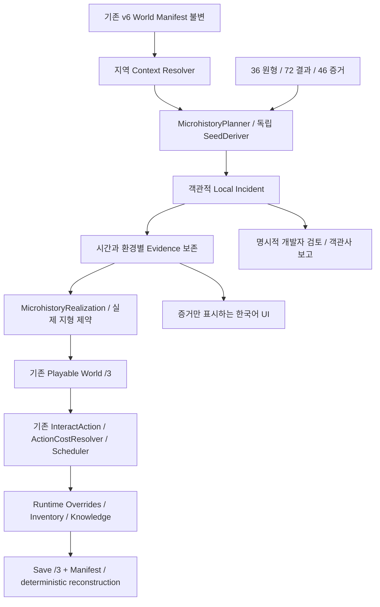

# History Generator v7 — Microhistory 계약

M049 사용자 요청, `codex/history-generator-v7-microhistory` 전용. 기반은 탐험/아트
`a8e3295`이며 M048 한국어 `f49c17c`, Phase C `3f7473c`, Phase B `12f48ba`,
Phase A `c0f1f92`를 포함한다. 기존 M049 탐험 문서는 별도 범위로 보존한다.
거시 생성기의 기본 `HistoryGenerator.VERSION == 5`를 바꾸지 않는다.



## 권위 경계

- `content/history/microhistory_v7.json`: 작성된 원형·전제·결과·증거 재료·가능한 행동.
- `MicrohistoryPlanner`: 지역 Context → Actor → Intent → Incident → Outcome → Evidence.
  거시 엔진, Reducer, Project, Scar, 인구 ledger에 쓰지 않는다.
- `MicrohistoryRealization`: 남아 있는 증거만 실제 타일/오브젝트/위험으로 실체화.
- `MicrohistoryInteractions`: 기존 InteractAction의 실행 어댑터. 별도 전투나 시계 없음.
- `MicrohistoryText`/기존 PO: 실제 흔적과 조사 결과만 표시. 목표·동기·사망자 전체 기록은
  플레이어 설명에서 읽지 않는다. 개발자 씬/보고서는 명시적으로 객관사를 열람한다.
- `HistoryRuntimeState`: 현재의 회수/제거/보강/지식만 저장. 과거 사건을 소급 변경하지 않는다.

정식 기본 F5는 바꾸지 않는다. 새 opt-in 씬은
`scenes/debug/microhistory_playground.tscn`이다. 이전 탐험 씬은 /2를 유지한다.

## 사건과 Canon

6계열 각각 6개 원형, 원형마다 다른 결과 두 가지. 원형 ID나 이름 치환은 다양성으로
계산하지 않는다. 수레 사고는 화물을 두고 간 경우와 가져간 경우의 재료가 다르다.
봉쇄된 돌봄방은 유기/사망과 자발적 격리 후 생존을 구분한다. 무덤은 죽음과 매장,
강제노동은 별개 controller/captive, 수레는 실제 역사적 handcart를 요구한다.

Actor는 익명의 인간 방문자 또는 작은 동물이다. 인간의 현재 존재를 가정하지 않고
거시 인구의 특정 구성원을 죽이거나 복제하지 않는다. 익명의 임시 방문 집단을
v6 현존 집단 census에 추가하지 않는다. 지성 종족·계통·고대 기계 의식은 생성하지 않는다.
기술은 수동 도구, 소규모 건축, 단순 덫에 한정한다. 강제 섭취 실험은 새로운 생명공학
능력이나 액체의 초자연적 정체를 확정하지 않는다. 자동 기계/NPC 생활 시뮬레이션은 없다.

`context`의 인구/위험/지형은 현재 지역의 적합성 필터다. 과거 특정 세력이 사건을
일으켰다는 증거가 아니다. 시설이 필요한 원형은 실제 그 지역의 shelter/archive/
human construction/ruin 조건을 요구하고, 해당 시설의 마지막 provenance 이후로만
사건 연대를 정한다. 그 주변의 임시 작업/주거 장면이며 시설 기능이나 재고를 복제하지 않는다.

`association.relation=coexistence`: 같은 장소에서 발생했음과 역사적 인과관계는 다르다.
시설 연관이 없는 사건도 독립 생성한다. 모든 사건에 퀘스트/보상/해답을 붙이지 않는다.

## 선택과 재현

지역당 4–7개 객관적 사건을 시도한다. 카테고리 가중치는 25/20/20/25/10이며
후보가 실제로 적합한 경우만 선택한다. tragedy/horror 가중치 배율은 정착지0.36,
일반길0.65, 폐허1.4, 위험지역2.2다. 현재 적합 후보가 없는 카테고리는 제거한다.
이 때문에 전체 수치가 정확히 35%로 맞아야 하는 계약은 아니다.

먼저 카테고리를 뽑고 그 안의 적합 원형을 뽑는다. 같은 지역에서는 원형 중복을 피한다.
원형별 실제 결과의 `severity`는 카테고리와 별도다. 구조 성공/자발적 격리 종료는
비극 원형에서 나와도 심각한 참사로 집계하지 않는다. `visibility`는 보존된 증거 비율이다.

`SeedDeriver(seed, [microhistory/1, region_id, ...])`로 밀도/카테고리/원형/결과/연대/
증거별 보존/공간 배치를 나눈다. ID 정렬 후 선택하여 카탈로그 순서 뒤집기에 불변이다.
지역 호출 순서와 다른 지역의 사건 수에 독립적이다. 정의를 추가해 후보가 달라지는
콘텐츠 개정은 재현 계약 변경이므로 generation revision을 올려야 한다.

최초 세 지역은 함께 생성한다. 현재 규모에서 lazy 생성 계층은 추가하지 않았다.
과거 스냅샷은 Manifest로 재구성하며 런타임 행동은 RNG 생성 스트림을 소비하지 않는다.

## 보존과 소멸

Recent=0년, Weathered=1–10년, Old=11–60년, Ancient=61년 이상이다.
최근 사건은 완전 보존, 유기물은 시간에 따라 0.78/0.45/0.18, 내구성 재료는
0.98/0.86/0.65 확률에서 시작한다. 물이 있는 지역의 젖은 환경과 정착지 정리/재사용은
보존을 낮춘다. 이는 지역 단위의 간략한 노출 모델이며 실제 기후/습도 시뮬레이션은 아니다.

발자국/쓸린 흙은 1년, 식물은 3년을 넘기면 소멸한다. 봉쇄된 방 밖의 종이는
60년 후 소멸한다. 오래된 목재/천은 추가로 감소한다. 봉쇄된 방은 보호된 침착 조건이다.
유해는 오래되면 뼈/파편으로 보이며, 오래된 덫은 장력이 남았다고 가정하지 않는다.
문이 실제 개폐 가능한 것은 10년 이내의 방뿐이다. 그보다 오래된 방은 열린 문틀이다.
나머지 증거가 없어지면 해당 장면 전체가 안 보이는 것도 정상이다.

## 공간 계약

11개 관계 양식: camp/work/garden/room/memorial/convoy/cache/rescue/nest/experiment/dig.
7×7 작은 구역의 실제 접근을 먼저 확인한다. 기존 #길, :바닥, R벽, 물, 물건, 위험,
스폰과 겹치지 않는다. 임시 장면 영역의 수목 일부를 제거할 수 있으나 기존 시설과
주요 통로는 보존한다. 주변 접근점은 기존 연결된 길에서 걸어갈 수 있어야 한다.

- 방의 출입구는 남쪽, 가구 봉쇄는 그 바로 안쪽. 문 밖의 유해는 실제 바깥이다.
- 도하 장면은 실제 물 셀에서 5칸 이내, 이동 사건은 실제 길에서 8칸 이내다.
- 각 증거는 장면 중심 4칸 이내의 서로 다른 셀을 차지한다.
- 현재 보강할 받침/최근 장전된 덫은 기존 Actor HP에 영향을 주는 위험이다.
- 배치 공간이 없으면 `no_safe_space`로 기록하고 다른 사건을 억지로 끼워 넣지 않는다.
- 접근 검사는 실제 열 수 있는 문/치울 수 있는 장해물을 허용하는 구조적 BFS다.
  실제 NPC를 피하며 걷는 자유 탐험의 성공 확률과 동일한 지표는 아니다.

기존 16×16 atlas를 조합하고 발자국/고랑/줄/고리/도구 등의 작은 픽셀 표시를 보완했다.
새 고품질 이미지 생성이나 외부 아트 의존성은 추가하지 않았다.

## 행동과 저장

| 행동 | 실제 결과 | 기존 기본 시간 |
|---|---|---:|
| Passive | 환경으로만 관찰, 가짜 실행 버튼 없음 | 없음 |
| I 조사 | 해당 증거 ID만 knowledge에 기록 | 500 |
| G 회수 | 살아남은 자재1을 inventory에 이전, taken | 500 |
| X 제거 | removed, 충돌/해당 덫 위험 해제 | 1,500 |
| P 보강 | 실제 자재1 소비, used, 받침 위험 해제 | 2,000 |

기존 손 기능·인접·생존·시간 비용 검사를 거친다. 조사만으로 보강을 잠금 해제하지 않는다.
회수·제거 반복은 거부되며 실패 행동에는 시간을 쓰지 않는다. Passive에 조사/사용을
붙이지 않는다. 기존 door interaction을 그대로 사용한다.

`history_play_save/3` + `history_zone/3`를 사용한다. /1과 /2는 그대로 decode한다.
저장에는 기존 Manifest와 override가 들어간다. 생성된 사건/문장은 중복 저장하지 않는다.
재생성된 baseline의 실제 객체에만 override가 허용되고, micro evidence는 각 실제 동사에
해당하는 taken/removed/used만 허용한다. 잘못된 저장은 현재 게임을 바꾸지 않고 거부한다.
카탈로그나 배치 계약을 바꾸면 /3 재현성이 바뀌므로 이후에는 명시적 버전 증가가 필요하다.

## v5 재사용 경계

실제 파일을 확인했다: history_v5 events283, social incidents44, archaeology traces116/
questions40/interactions60/actions21. 모두 변경하지 않는다.
`v5_material_archetype`은 maintenance_site/trade_receipt/arrival_houses/abandoned_office
등 실재하는 원형 어휘에 연결한다. 이것은 해당 Trace 인스턴스가 이곳에 있다는 주장이 아니다.
`compatible_traces()`는 명시적으로 전달된 실제 v5 Trace의 ID와 source_event_ids만 반환하고
`material_analogy`, `current_operation=unverified`를 유지한다. 실제 v5 생성 결과를 테스트한다.

v6 Manifest에는 v5 Trace가 없으므로 현 플레이 씬에서 v5 조사 Question 권한을 자동으로
부여하지 않는다. v5 `HistoryInvestigation.perform/permissions/propose` 계약과 M048
실행 Action을 대체하지 않는다. 완전한 v5 질문/증거의 공간 바인딩은 후속 작업이다.

## 재현

```bash
godot --path . scenes/debug/microhistory_playground.tscn
godot --headless --path . --script tests/test_microhistory.gd
godot --headless --path . --script tools/analyze_microhistory.gd -- --count=500
godot --path . --rendering-method gl_compatibility --script tools/capture_microhistory.gd
bash tools/check_godot.sh
```

검토 씬은 Seed/지역/사건 선택, 위치 이동, 객관사와 증거 대조를 지원한다. 명시적인 DEBUG
위치 이동은 실제 여행 검증에 포함하지 않는다. 실제 걸어서 회수/보강/왕복은 집중 테스트가
기존 Action으로 수행한다. [측정과 한계](../reviews/microhistory_v7/report.md)를 참조한다.
